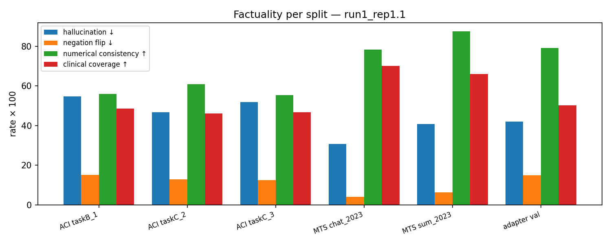
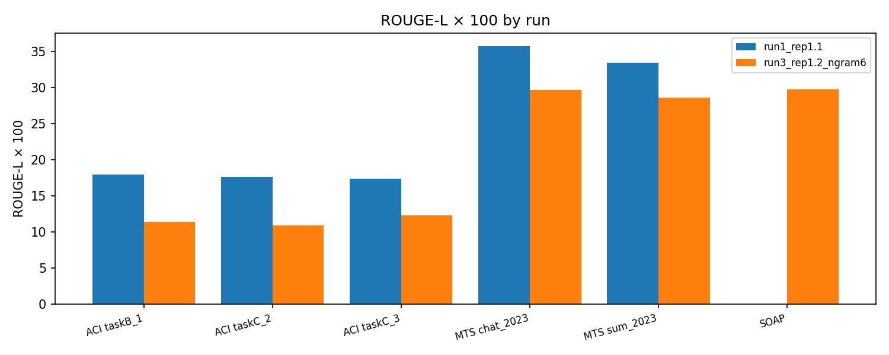
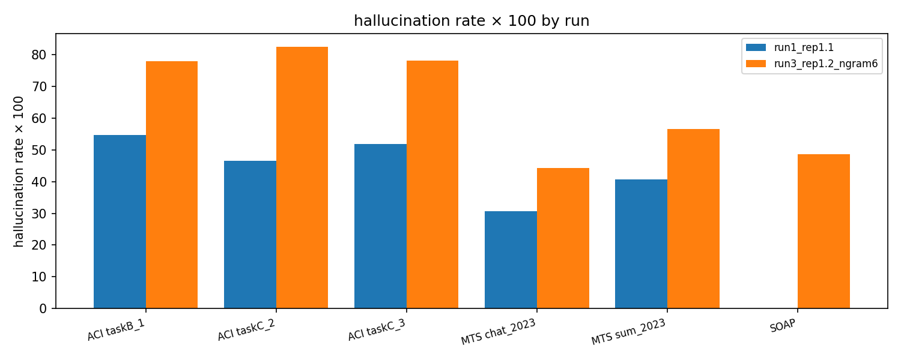

# Person 3 — Evaluation Pipeline and Preliminary Baseline Results (Review 2)

Owner: evaluation role. Scope: the evaluation harness (built while Person 2 was training) and the
preliminary evaluation of the plain QLoRA baseline. Every number here is produced by
`python -m src.eval.run_eval` and stored under `reports/eval_baseline/<label>/`.

| # | Task | Where |
|---|---|---|
| 1 | Build the evaluation pipeline | `src/eval/` — `metrics.py`, `factuality.py`, `run_eval.py`; tests in `tests/test_factuality.py` | §1 |
| 2 | ROUGE-1 / ROUGE-2 / ROUGE-L, BERTScore vs. reference summaries | `metrics.py` | §1.1 |
| 3 | Basic factuality checking: hallucinated information, incorrect diagnosis, incorrect medication / dosage, negation errors, numerical errors, missing clinical information | `factuality.py` (on the CFE of `src/cfe/`) | §1.2 |
| 4 | Preliminary hallucination rate, negation-flip rate, numerical consistency, clinical-information coverage | `run_eval.py` aggregates | §1.3, §3 |
| 5 | Tables, graphs, example errors | `metrics.md`, `figures/*.png`, `examples.md`, `comparison.md` | §3–§5 |
| 6 | Preliminary evaluation results for Review 2 | this document | §3–§6 |

---

## 1. The pipeline

Input is the prediction schema fixed with Person 2 (`REVIEW2_BASELINE.md` §8.3): one JSONL per test
split with `source_dialogue`, `reference_summary`, `prediction`, `truncated`, decoding parameters and
ids — self-contained, no joins. `run_eval.py` scores every item, aggregates per split, and writes
`per_item.jsonl` (every metric and every flagged entity per prediction), `metrics.json/.md`,
`examples.md` and `figures/`. `--compare` builds side-by-side tables and plots for all evaluated runs.

### 1.1 Standard metrics (`src/eval/metrics.py`)

| metric | implementation | note |
|---|---|---|
| ROUGE-1, ROUGE-2, ROUGE-L, ROUGE-Lsum (F1) | `rouge_score`, Porter stemming on | same configuration as the ACI-Bench / MEDIQA-Chat 2023 official scorers → comparable to published baselines |
| BERTScore F1 | `bert_score`, `roberta-large` layer 17, English baseline rescaling | rescaled values (−1…1); negative means "less similar than a random sentence pair" |
| length ratio | words(prediction) / words(reference) | 0.8–1.2 is healthy |
| degeneration diagnostics | share of 4-grams that recur in the output; longest comma-separated run; `degenerate = repeated-4-gram share > 0.5 or list ≥ 25 items` | flags the two failure modes seen in the baseline (loops, runaway lists) so every table can be read with and without them |

### 1.2 Factuality checks (`src/eval/factuality.py`)

The transcript, the reference note and the generated note are each converted into facts by the
rule-based Clinical Fact Extractor (`src/cfe/`, see `docs/PERSON1_DATA_PIPELINE.md` §7): canonical
entity, category, polarity (negation), certainty, section. A generated note is then compared against
the **transcript** (faithfulness — the transcript is the only ground truth for what was said) and
against the **reference** (coverage and polarity agreement).

| report error type | operational definition | output fields |
|---|---|---|
| **Hallucinated information** | an entity (symptom / history / diagnosis / medication / investigation) in the prediction whose canonical form appears nowhere in the transcript; *strict* variant additionally requires absence from the reference (tolerates lexicon misses on the ASR-style dialogue) | `unsupported_vs_source`, `hallucination_rate`, `hallucination_rate_strict` |
| **Incorrect diagnosis** | a diagnosis the prediction *asserts* (ASSESSMENT/PLAN/CC context or a diagnostic cue, polarity present) that is neither mentioned as a condition in the transcript nor asserted in the reference; the converse (reference-asserted diagnosis absent from the prediction) is *missing diagnosis* | `incorrect_diagnosis`, `missing_diagnosis` |
| **Incorrect medication / dosage** | a specific drug (class words like *antibiotic* excluded) absent from transcript and reference; a (drug, value, unit) whose drug the transcript names but with a different dose | `incorrect_medication`, `missing_medication`, `dosage_mismatch` |
| **Negation errors** | a symptom / history / diagnosis / medication entity present in both prediction and reference with opposite polarity (e.g. reference *denies chest pain*, prediction *reports chest pain*); investigations are excluded because *"troponin negative"* is a result, not an absent test; also computed against the transcript | `negation_flips`, `negation_flip_rate`, `negation_flip_rate_vs_source` |
| **Numerical errors** | a number in the prediction (digits, decimals, BP pairs; word numbers in the transcript are converted: *twenty five* → 25) that occurs in neither transcript nor reference | `unsupported_numbers`, `numerical_consistency` |
| **Missing important clinical information** | reference entities absent from the prediction, overall and per category; *important* = diagnosis + medication + symptom + history | `missing_by_category`, `clinical_coverage`, `clinical_coverage_important`, `coverage_<category>` |

### 1.3 Preliminary rates

| rate | per item | split aggregate |
|---|---|---|
| hallucination rate ↓ | unsupported entities / prediction entities | item mean (reported) and micro (pooled entities; dominated by long degenerate outputs) |
| negation-flip rate ↓ | polarity conflicts / entities shared with the reference | item mean and micro |
| numerical consistency ↑ | 1 − unsupported numbers / prediction numbers | item mean and micro |
| clinical-information coverage ↑ | reference entities found in the prediction / reference entities | item mean, micro, per category |

Items with a zero denominator are skipped for that rate. Two MTS-Dialog test items whose dialogue
also occurs in training with another section target (data audit §4) are flagged (`flagged_near_dup`);
their ROUGE-L is 1.00 / 0.04, i.e. they do not move a 400-item mean.

### 1.4 Validation of the checker

`tests/test_factuality.py` (8 tests) constructs a faithful note (all rates clean) and then injects
each error type into it — a hallucinated diagnosis, a flipped negation, a changed dose, a swapped drug,
changed numbers, dropped medications — and asserts that exactly that error is reported. All pass, with
the 14 extractor tests. Limitations are in §6.

## 2. What was evaluated

| label | predictions | decoding | splits |
|---|---|---|---|
| **run1_rep1.1** | `outputs/kaggle_run1_old_decoding/…` (17 Sep, recovered from the cancelled kernel) | greedy, `max_new_tokens` 768, `repetition_penalty` 1.1 | ACI-Bench ×3, MTS-Dialog ×2, val (20) — DialogueSOAP lost to the 12 h cap |
| **run3_rep1.2_ngram6** | `outputs/kaggle/outputs/baseline_qlora_llama31_8b/…` (19 Sep, kernel B, sha-pinned adapter) | greedy, 1024, 1.2, 6-gram block on generated tokens | all six splits, val (20), **zero-shot base control** on the same 20 val items |

Same adapter (`14e71261…`, best eval loss at step 200) in both. Run 2 (smoke adapter) is excluded.
BERTScore was computed once per prediction on CPU (roberta-large, ~17 min per run) and cached.

## 3. Results

### 3.1 Standard metrics (×100, item means)

| split | n | system | ROUGE-1 | ROUGE-2 | ROUGE-L | ROUGE-Lsum | BERTScore | len ratio | truncated | degenerate | ROUGE-L excl. trunc./degen. |
|---|---|---|---|---|---|---|---|---|---|---|---|
| ACI-Bench taskB-1 | 40 | run 1 | 29.3 | 11.4 | **17.9** | 26.4 | −1.8 | 1.28 | 30 | 18 | 31.2 (n=10) |
| | | run 3 | 21.9 | 6.6 | 11.4 | 19.3 | −13.6 | 1.28 | 29 | 21 | 19.9 (n=11) |
| ACI-Bench taskC-2 | 40 | run 1 | 29.7 | 12.5 | **17.6** | 27.3 | −1.6 | 1.21 | 29 | 20 | 29.6 (n=11) |
| | | run 3 | 20.9 | 6.2 | 10.9 | 18.5 | −16.4 | 1.11 | 28 | 25 | 17.2 (n=11) |
| ACI-Bench taskC-3 | 40 | run 1 | 29.7 | 11.5 | **17.4** | 27.1 | −1.9 | 1.20 | 31 | 17 | 30.1 (n=8) |
| | | run 3 | 23.0 | 7.2 | 12.3 | 20.8 | −14.8 | 1.02 | 27 | 25 | 21.2 (n=12) |
| MTS-Dialog chat-2023 | 200 | run 1 | 42.2 | 19.6 | **35.8** | 35.8 | 39.6 | 1.15 | 9 | 8 | 37.2 (n=190) |
| | | run 3 | 34.8 | 13.7 | 29.7 | 29.7 | 30.7 | 1.85 | 5 | 17 | 31.7 (n=183) |
| MTS-Dialog sum-2023 | 200 | run 1 | 40.0 | 16.2 | **33.5** | 33.5 | 38.8 | 1.02 | 2 | 3 | 33.7 (n=197) |
| | | run 3 | 34.1 | 11.3 | 28.6 | 28.6 | 30.7 | 1.36 | 6 | 12 | 29.9 (n=188) |
| DialogueSOAP test (synthetic) | 250 | run 3 | 46.7 | 16.4 | **29.7** | 38.5 | 26.3 | 0.97 | 7 | 7 | 30.3 (n=243) |
| validation (10 ACI + 10 MTS) | 20 | run 1 adapter | 33.0 | 12.6 | 24.0 | 28.6 | 20.1 | 1.07 | 7 | 5 | 28.8 (n=13) |
| | | run 3 adapter | 21.0 | 6.1 | 14.7 | 18.3 | 7.5 | 1.29 | 9 | 9 | 19.4 (n=11) |
| | | **zero-shot base** (run 3 decoding) | 35.8 | 11.7 | 21.2 | 30.9 | 16.2 | 2.71 | 0 | 0 | 21.2 (n=20) |

### 3.2 Factuality (×100, item means; micro rates in `metrics.md`)

| split | system | hallucination ↓ | halluc. strict ↓ | negation-flip ↓ | numerical consistency ↑ | clinical coverage ↑ | coverage (important) ↑ | hallucination excl. degenerate |
|---|---|---|---|---|---|---|---|---|
| ACI-Bench taskB-1 | run 1 | **54.7** | 51.5 | 15.1 | 55.9 | 48.6 | 56.5 | 39.1 |
| | run 3 | 77.9 | 75.3 | 15.1 | 66.4 | 46.7 | 51.7 | 46.0 |
| ACI-Bench taskC-2 | run 1 | **46.6** | 41.5 | 12.9 | 60.9 | 46.1 | 53.1 | 29.2 |
| | run 3 | 82.6 | 80.5 | 17.5 | 52.2 | 47.2 | 53.5 | 59.6 |
| ACI-Bench taskC-3 | run 1 | **51.8** | 48.1 | 12.4 | 55.3 | 46.7 | 53.2 | 34.3 |
| | run 3 | 78.2 | 75.3 | 20.7 | 71.0 | 50.8 | 55.8 | 53.6 |
| MTS-Dialog chat-2023 | run 1 | **30.7** | 23.7 | 4.1 | 78.4 | 70.2 | 70.7 | 27.2 |
| | run 3 | 44.3 | 38.8 | 6.5 | 80.2 | 56.6 | 58.0 | 38.2 |
| MTS-Dialog sum-2023 | run 1 | **40.8** | 24.4 | 6.2 | 87.5 | 66.0 | 68.5 | 41.2 |
| | run 3 | 56.7 | 42.7 | 6.0 | 78.8 | 56.8 | 58.6 | 53.8 |
| DialogueSOAP test | run 3 | 48.6 | 41.0 | 3.6 | 74.3 | 70.7 | 71.6 | 47.3 |
| validation (20) | run 1 adapter | 42.1 | 38.9 | 14.9 | 79.1 | 50.1 | 53.7 | 29.8 |
| | run 3 adapter | 72.9 | 71.7 | 6.7 | 76.9 | 40.0 | 45.6 | 45.1 |
| | **zero-shot base** | **18.0** | 14.2 | 14.4 | 73.4 | **71.6** | 70.5 | 18.0 |

**Headline (five official test splits pooled, n = 520, item means ×100):**

| system | ROUGE-L | hallucination ↓ | negation-flip ↓ | numerical consistency ↑ | clinical coverage ↑ |
|---|---|---|---|---|---|
| **plain QLoRA baseline — run 1 decoding (primary)** | **30.7** | **40.4** | **8.2** | **71.1** | **61.3** |
| plain QLoRA baseline — run 3 decoding | 25.1 | 59.3 | 10.7 | 72.0 | 54.0 |
| run 1, clean outputs only (not truncated, not degenerate; n = 416) | 35.1 | 33.8 | 5.0 | 77.4 | 69.3 |

### 3.3 Coverage by category (run 1 unless noted, ×100)

| split | symptom | medical history | diagnosis | medication | investigation |
|---|---|---|---|---|---|
| ACI-Bench (3 splits, range) | 55–59 | 54–62 | 46–49 | 40–48 | 30–37 |
| MTS-Dialog chat / sum | 67 / 60 | 49 / 53 | 66 / 65 | 79 / 71 | 28 / 22 |
| DialogueSOAP (run 3) | 73 | 79 | 69 | 61 | 69 |
| zero-shot base, val (run 3) | 70 | 60 | 79 | 78 | 72 |

Medications and investigations are the weakest categories on real notes: the baseline drops
roughly half of the drugs and two thirds of the ordered tests that the reference note records.

### 3.4 Error counts (items affected, run 1 / run 3)

| split | n | incorrect dx | missing dx | incorrect med | missing med | dosage mismatch | negation flip | numerical error |
|---|---|---|---|---|---|---|---|---|
| ACI-Bench taskB-1 | 40 | 1 / 10 | 22 / 26 | 2 / 7 | 23 / 25 | 0 / 2 | 24 / 22 | 26 / 23 |
| ACI-Bench taskC-2 | 40 | 4 / 19 | 24 / 26 | 2 / 10 | 27 / 30 | 0 / 2 | 23 / 25 | 31 / 29 |
| ACI-Bench taskC-3 | 40 | 7 / 20 | 25 / 24 | 4 / 10 | 27 / 26 | 4 / 5 | 22 / 28 | 31 / 19 |
| MTS-Dialog chat-2023 | 200 | 1 / 7 | 4 / 5 | 1 / 2 | 9 / 16 | 1 / 0 | 11 / 14 | 29 / 23 |
| MTS-Dialog sum-2023 | 200 | 1 / 6 | 3 / 6 | 3 / 9 | 9 / 12 | 0 / 1 | 13 / 12 | 15 / 23 |
| DialogueSOAP test | 250 | — / 152 | — / 96 | — / 49 | — / 72 | — / 15 | — / 43 | — / 151 |

## 4. Figures

`reports/eval_baseline/<label>/figures/`: `rouge_per_split.png`, `factuality_per_split.png`,
`length_ratio_hist.png`, `error_types.png` (% of headline items affected per error type),
`rougeL_vs_hallucination.png` (per-item scatter). `reports/eval_baseline/figures/`:
`compare_rougeL.png`, `compare_hallucination.png`, `compare_coverage.png`, `compare_negflip.png`
(run 1 vs run 3 per split).







## 5. Example errors

`reports/eval_baseline/<label>/examples.md` holds, per split, the best and worst item and one item per
error type with the transcript excerpt, the reference, the generated note and the flags. Three
representative cases from the baseline (run 3 unless noted):

**Numerical + hallucination — `aci_bench_test_taskB_1_D2N123-aci`.** Transcript: *"something that I
have noticed over the last four to five weeks"*. Generated: *"dysphagia … which started approximately
**5-6 months** ago"* (flagged: unsupported number 6) and *"56-year-old **white** male"* (race is never
mentioned). The note then degenerates into a 200-item ROS denial list (*denies … sialadenitis,
laryngismus, periorbital puffiness, retrobulbar neuritis …*) — 91% of its entities are unsupported.

**Incorrect medication — `aci_bench_test_taskB_1_D2N093-virtassist`.** Generated note lists
*testosterone* and *calcium supplement*; neither appears in the transcript, while the transcript's
*furosemide, insulin, omeprazole* are missing. 33 numbers in the note (lab values 0.05, 0.7, 1.02,
1.04 …) occur nowhere in the transcript (numerical consistency 0.11).

**Negation flip — MTS-Dialog `test_chat_2023_170`** (run 1). Reference: *"He denies any weakness,
numbness, tingling, dysarthria or diplopia."* Generated: *"He has had some episodes of diplopia. He has
had some episodes of dysarthria. … episodes of right-sided numbness."* — three denied findings asserted
as present (`negation_flips`: double vision, numbness, slurred speech), inside a loop that also invents
syncope, tremor and photophobia.

**A checker false positive that changed the metric — MTS-Dialog `test_chat_2023_60`.** Reference:
*"cardiac enzymes were negative x1"*; generated: *"CBC, BMP, cardiac enzymes negative x1"*. The first
version of the checker counted *CBC* and *BMP* as negation flips: for a test, "negative" is a *result*,
not the absence of the test. Investigations are therefore excluded from the negation-flip metric (it is
computed over symptoms, history, diagnoses and medications only).

**Degenerate loop (run 1) vs runaway list (run 3) — `aci_bench_test_taskB_1_D2N088-virtassist`.**
Run 1: *"He has been having some difficulty with odynophagia. He has been having some difficulty with
globus sensation. …"* (45% of its 4-grams recur; ROUGE-L 17.3, hallucination 66%). Run 3, same item:
*"… Denies weight loss, night sweats, chills, abdominal pain, flank pain, urinary frequency, … ,
Takayasu arteritis, polymyalgia rheumatica …"* (196-item list; ROUGE-L 7.2, 86% of entities
unsupported).

**Clean output, for contrast — `mts_dialog_test_chat_2023_2`.** Reference: *"MSK: Negative myalgia,
negative joint pain, negative stiffness, negative weakness, negative back pain."* Generated:
*"MUSCULOSKELETAL: Negative for myalgias, arthralgias, stiffness, weakness and positive for negative
back pain."* — every polarity agrees (0 flips), ROUGE-L 0.54.

## 6. Preliminary conclusions for Review 2

1. **The plain QLoRA baseline works on short, well-represented targets and fails on long notes.**
   On MTS-Dialog sections the baseline reaches ROUGE-L 35.8 / 33.5 (published MEDIQA-Chat 2023 systems:
   ~35–45) with 4.1–6.2% negation flips and 66–70% clinical coverage. On ACI-Bench full notes it
   reaches 17.4–17.9 (published LED/BART baselines: ~40–45) because 72–78% of outputs hit the token cap:
   the adapter (selected at step 200, trained on a mix that is only 1.6% full notes) has not learnt how a
   full note ends. Restricted to the 29 clean ACI-Bench outputs, ROUGE-L is 29.6–31.2 — the model *can*
   write the note; it cannot stop.
2. **Anti-repetition decoding trades repetition for hallucination.** Run 3 (`repetition_penalty` 1.2
   + 6-gram block) removed the loops and moved every metric the wrong way: ACI-Bench ROUGE-L 17.9 → 11.4,
   hallucination 55 → 78%, MTS-Dialog ROUGE-L 35.8 → 29.7, coverage 70 → 57%. Forbidding the model's
   preferred (repetitive but grounded) continuation makes it emit *novel* content, which on a clinical
   note means invented findings. Run 1 is therefore the primary baseline for the results table, and
   decoding-side repetition control is *not* a factuality tool — this is a concrete argument for
   fact-constrained generation (Review 3) rather than decoding heuristics.
3. **Fine-tuning reduced factuality relative to the un-tuned base on the validation items.** The
   zero-shot Llama-3.1-8B-Instruct, given the same prompt, hallucinates 18% of entities and covers 72% of
   the reference facts, versus 42–73% and 40–50% for the adapter — while being 2.7× too long and
   scoring lower on ROUGE. The adapter learnt the *form* of a note (length, sections, terse style) faster
   than the discipline of writing only what was said. This is exactly the gap the FaCTS fact table and
   ORPO preference tuning target; the zero-shot row is kept as a control in every Review 3 table.
4. **Where the baseline loses information.** Medications (40–48% coverage on ACI-Bench) and
   investigations (30–37%) are the least covered categories; 23–27 of 40 ACI-Bench notes miss at least
   one medication the reference records. Symptoms are the best covered (55–59%). Negation flips occur in
   55–60% of ACI-Bench notes (12–15% of shared entities) and ~6% of MTS-Dialog sections.
5. **Numbers are unreliable in the generated notes.** Numerical consistency is 55–61% on ACI-Bench
   (26–31 of 40 notes contain at least one number that appears nowhere in the transcript or reference:
   invented lab values, altered durations) and 78–88% on MTS-Dialog.
6. **Standard metrics and factuality metrics disagree by design.** ROUGE-L correlates with
   degeneration (a runaway list still overlaps the reference vocabulary), while the hallucination rate
   separates the clean outputs from the degenerate ones (39% vs 90% on ACI-Bench). Both must be reported;
   `rougeL_vs_hallucination.png` shows the spread.

### Limitations of this preliminary evaluation

- The factuality checker is lexicon-based: an entity phrased outside the lexicon is invisible to it, and
  the transcript side (ASR-style, colloquial) is harder to extract from than the note side, which
  inflates the hallucination rate; the *strict* variant (also accepting the reference) gives the lower
  bound. The extractor's manual spot-check precision is 87.5% on note facts (`PERSON1_DATA_PIPELINE.md`
  §7.2), so rates carry roughly ±5 points of extraction noise.
- "Incorrect diagnosis" uses the transcript's condition mentions as support, so a diagnosis the doctor
  states in the dialogue is never flagged even if the reference disagrees.
- Negation-flip rate is computed on entities shared with the reference; items with no shared entities
  (degenerate outputs) are excluded from that mean.
- No human evaluation yet (Review 3 reader study, MODEL_PLAN.md §5.3); no confidence intervals (single
  greedy run, deterministic) — the per-item files allow bootstrapping later.
- DialogueSOAP is synthetic; its numbers are reported for completeness and are not headline numbers.

## 7. Reproduce

```bash
python -m src.eval.run_eval --run outputs/kaggle_run1_old_decoding/outputs/baseline_qlora_llama31_8b --label run1_rep1.1 --bertscore
python -m src.eval.run_eval --run outputs/kaggle/outputs/baseline_qlora_llama31_8b --label run3_rep1.2_ngram6 --bertscore
python -m src.eval.run_eval --compare            # reports/eval_baseline/comparison.md + figures/
python -m pytest tests -q
```
