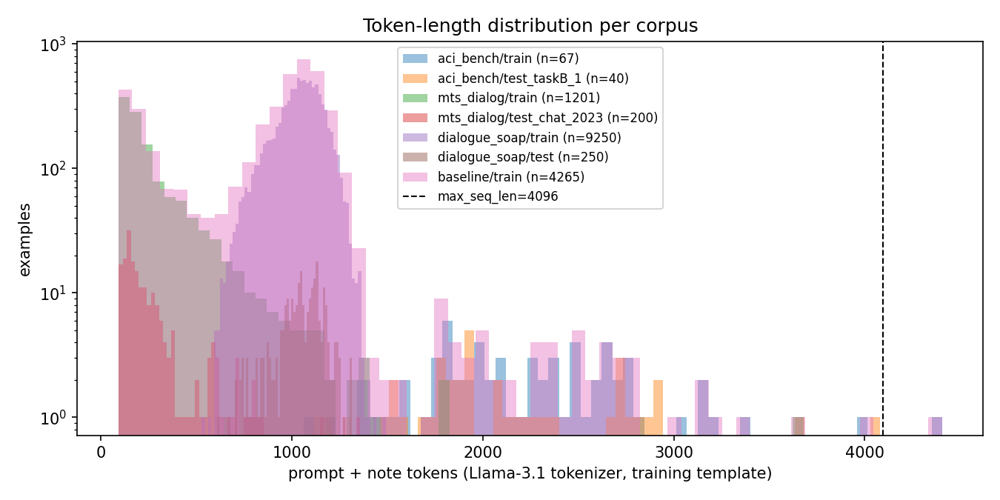

# Data audit — processed corpora

Generated 2026-09-21 22:48. Training window 4096 tokens.

## 1. Records, unusable samples, duplicates, lengths

| corpus | split | n | unusable | exact dup (within) | src words p50/p95/max | tgt words p50/p95/max | prompt tok p50/p95/max | total tok p50/p99/max | > 4096 tok |
|---|---|---|---|---|---|---|---|---|---|
| aci_bench | train | 67 | 0 | 0 | 1240/1960/3050 | 404/620/884 | 1619/2411/3635 | 2195/4129/4405 | 1 |
| aci_bench | validation | 20 | 0 | 0 | 1241/1712/1789 | 435/612/829 | 1572/2182/2274 | 2239/3026/3030 | 0 |
| aci_bench | test_taskB_1 | 40 | 0 | 0 | 1098/1905/2392 | 397/653/785 | 1429/2402/2885 | 1938/3913/4079 | 0 |
| aci_bench | test_taskC_2 | 40 | 0 | 0 | 1261/2414/2681 | 430/733/884 | 1590/3028/3275 | 2135/4312/4461 | 1 |
| aci_bench | test_taskC_3 | 40 | 0 | 0 | 1297/2138/2707 | 419/641/771 | 1641/2718/3220 | 2224/3969/4287 | 1 |
| mts_dialog | train | 1201 | 131 | 2 | 64/339/1509 | 14/150/1020 | 169/533/2254 | 193/1157/3681 | 0 |
| mts_dialog | validation | 100 | 10 | 0 | 54/304/630 | 15/138/295 | 155/494/872 | 187/1010/1152 | 0 |
| mts_dialog | test_chat_2023 | 200 | 14 | 0 | 66/312/608 | 14/154/403 | 169/485/853 | 197/834/1358 | 0 |
| mts_dialog | test_sum_2023 | 200 | 13 | 1 | 59/330/978 | 12/177/565 | 162/533/1443 | 183/1067/2121 | 0 |
| dialogue_soap | train | 9250 | 0 | 0 | 420/494/604 | 246/312/398 | 688/794/946 | 1050/1292/1491 | 0 |
| dialogue_soap | validation | 500 | 0 | 0 | 418/492/559 | 245/312/384 | 690/790/876 | 1052/1276/1315 | 0 |
| dialogue_soap | test | 250 | 0 | 0 | 422/496/550 | 243/315/340 | 698/790/859 | 1052/1289/1314 | 0 |

## 2. Near-duplicates (SimHash, 3-word shingles, Hamming ≤ 3)

| corpus | pairs within a split | pairs across splits | pairs involving a test split |
|---|---|---|---|
| aci_bench | 0 | 0 | 0 |
| mts_dialog | 3 | 9 | 7 |
| dialogue_soap | 0 | 0 | 0 |

## 3. Leakage checks (baseline_train + baseline_val vs. the six test splits)

- id overlap train/val: 0, train/test: 0, val/test: 0
- exact source-dialogue overlap with test: 0 (after make_baseline_split.py dropped 3: ['mts_dialog_train_989', 'mts_dialog_train_926', 'mts_dialog_train_901'])
- exact target-note overlap with test: 131 [('mts_dialog_train_142', 'mts_dialog_test_chat_2023_106'), ('mts_dialog_train_388', 'mts_dialog_test_sum_2023_65'), ('mts_dialog_train_868', 'mts_dialog_test_sum_2023_150'), ('mts_dialog_train_725', 'mts_dialog_test_sum_2023_65'), ('mts_dialog_train_109', 'mts_dialog_test_sum_2023_180')]
- near-duplicate source dialogues (mix vs test, Hamming ≤ 3): 2
- train_manifest.json SHA-256 matches on disk: train=True, val=True
- **status: passed**

## 4. Baseline mix

- train: {'n': 4265, 'mix': {'dialogue_soap': 3000, 'mts_dialog': 1198, 'aci_bench': 67}, 'total_tokens': {'p50': 992, 'p90': 1180, 'p95': 1234, 'p99': 1991, 'p100': 4405}, 'over_max_seq_len': 1, 'over_max_seq_len_ids': ['aci_bench_train_D2N021-virtscribe']}
- val: {'n': 220, 'mix': {'aci_bench': 20, 'mts_dialog': 100, 'dialogue_soap': 100}}
- test: {'aci_bench/test_taskB_1': 40, 'aci_bench/test_taskC_2': 40, 'aci_bench/test_taskC_3': 40, 'dialogue_soap/test': 250, 'mts_dialog/test_chat_2023': 200, 'mts_dialog/test_sum_2023': 200}

## 5. Lengthy conversations

The training window is 4096 tokens (prompt + note). Kernel A *drops* any example whose rendered length exceeds it rather than truncating (truncating a note teaches the model to stop early; truncating a transcript removes facts the note still asserts). At inference the prompt-only limit is the base model's 128k context, so no test conversation is cut. Counts of dropped examples per split are in the table above (`> 4096 tok`).

